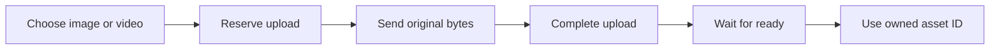

# How the work fits together

## Create an image

You describe the image. The agent chooses an approved project/current session, discovers the model/settings if needed, and calls `quote_generation` for an `image` operation. It submits with a fresh quote, an explicit cap and a stable request ID using `generate_image`.

The returned `batch_id` is accepted work, not a finished file. In a UI-capable client, `show_generation` can display image-job progress in one persistent view. Otherwise the agent checks `get_job` at `poll_after_seconds` intervals and retrieves completed assets.

Quotes expire after five minutes. A changed prompt, model or setting needs a matching new quote. Generation must fit both the request cap and the connection/account limits.

## Edit a reference

Use `list_assets` to choose an existing image or add one through the upload flow below. `edit_image` takes one owned PNG/JPEG/WebP asset as `source_image_asset_id`, a change prompt and an `image_edit` quote.

“Make the background terracotta; keep the product and label” is an edit. It uses the source image. Asking to extract a prompt and recreate a different image from that description is a different creative intent; an agent should not silently attach a reference you did not ask to preserve.

## Animate the image

`generate_video` takes owned image references in `image_asset_ids` where the selected video model supports them. Reuse the same project/session from the image work. After completion, `show_assets` can include both source images and resulting videos, so a replacement result card does not discard their relationship.

## Edit a video

`edit_video` uses `source_video_asset_id`, a change prompt and a `video_edit` quote. It preserves the verified source duration, up to 30 seconds, and produces one output.

For supported models, one owned first-frame image can also be supplied in `image_asset_ids`. Check `get_model` → `operations.edit.supports_first_frame_image` and `max_image_references`; do not infer this from image-to-video support alone. The original video supplies performance/timing and the image supplies the visual target.

## Upload a local reference

A compatible client can call `show_upload` to open a private file picker. Opening the view does not upload or generate a file; you choose it. Clients/tools with file access can instead use `reserve_upload`, send the exact bytes with the returned signed PUT ticket, call `complete_upload`, and poll `get_upload` until `ready` is true.

Use only the ticket’s returned headers for storage. Do not send an OAuth bearer token to the storage URL. Images fit 10 MiB and videos 50 MiB; model/operation limits also apply. Blocked, failed, scanning or expired uploads are not ready references.

This pathway requires approved `assets:write` scope. A previous connection without that scope must be reauthorized; it is not broadened silently. A server cannot automatically read an arbitrary attachment from your chat or local drive.

## Keep the session

A session is a saved collection of work inside an owned project. It supports both images and videos. Keep its `session_id` across related prompts and media changes.

- `list_sessions` finds saved work.
- `resume_session` reads recent results and pending jobs without generating anything.
- `create_session` reuses a suitable existing session by default. `force_new: true` is for an explicit request to start separately.
- `create_project` is available only when the connection permits new projects.

Closing a tab or disconnecting a client does not cancel accepted work. Reconnect with access to the same project and resume the session or known batch.

## Result cards and original files

`get_asset` supplies metadata, fresh original/download links, and optional native image/poster pixels. `show_generation` is for accepted image jobs and live image progress; call it once for the selected jobs, not repeatedly as a status loop. `show_assets` presents completed image/video selections and can retain their source images.

UI support belongs to the host: some clients render the gallery, some render native image content, and others use text/links. Completed videos can play in the gallery where supported. The tools still return usable data when no UI is available.

Download the full original using `download_url`. The included inline pixels or gallery thumbnail are previews, not a replacement for the original. Links expire after 15 minutes; retrieve the same asset ID again for a fresh URL. An asset does not disappear when a link expires.

## Authentication and credits

The client connects to `mcp.creativly.ai`, discovers OAuth and opens Creativly’s normal sign-in/authorization website. Your approved projects, permissions and spending limits apply to tool calls.

Model names, availability and prices are discovered dynamically. Defaults are Nano Banana 2.1 for image work and Gemini Omni 1.1 Flash for video work, unless you ask for a different compatible model. Platform generations use your account balance; configured BYOK operations, where available through MCP, have separate provider/account requirements. A REST API key is not a provider BYOK key or an OAuth token.

Read tools, quotes, uploads and display tools do not submit a paid generation. A generation requires a current quote and an explicit `max_credits`; both account and connection limits are checked. The active service’s limits are authoritative.

Keep a stable `client_request_id` for an uncertain retry. If the batch was accepted, poll it rather than submit a new request. Tool errors have safe messages; do not treat a disconnected chat as a failed provider run or start another paid job to “recover” it.
